# Choose-Your-Trainer — Database Design

Postgres is the source of truth. Qdrant holds embeddings only. Original files (PDFs, raw OCR) live in file storage.
Tables are tagged **MVP** (build now) or **Later** (build when the feature lands).

## 0. Conventions (apply to every table)

| Rule | Why |
|---|---|
| **Postgres 18+.** `uuid` PKs default to `uuidv7()`; `bigint generated always as identity` for internal-only tables (`exercises`, `llm_usage`) | v7 is time-ordered → ~25% smaller index and much faster inserts than random v4, still safe to expose in URLs. bigint is smaller still but leaks row counts, so only where ids never reach the client. |
| `timestamptz` for every timestamp, never `timestamp` | Clients and coaches span time zones |
| `numeric` for weights/reps/RIR/macros; `real` only for scores | Floats drift on sums (weekly volume, macro totals) |
| `text` + `CHECK (x IN (...))` for statuses/roles, not `CREATE TYPE ... AS ENUM` | Enum values can't be removed or renamed easily; a check is one migration |
| **Single-column rules live in `DOMAIN`s** (defined once in the first migration, reused by every column):<br>`text_100` · `text_200` · `text_1000` · `text_2000` = `text CHECK (char_length(VALUE) <= N)`<br>`qty` = `numeric CHECK (VALUE >= 0)`<br>`rir_value` = `numeric CHECK (VALUE BETWEEN 0 AND 10)`<br>`pos_int` = `int CHECK (VALUE >= 1)`<br>`count_int` = `int CHECK (VALUE >= 0)`<br>`score` = `real CHECK (VALUE BETWEEN 0 AND 1)` | One definition instead of ~30 copies; changing a limit is one `ALTER DOMAIN`. SQLAlchemy 2.0 maps them with `postgresql.DOMAIN`. |
| Where each domain is used:<br>`text_100`: `users.name`<br>`text_200`: `documents.title`, `conversations.title`<br>`text_1000`: `message_feedback.comment`<br>`text_2000`: `workout_sessions.notes`, `coach_feedback`, `meal_logs.notes`<br>`qty`: every `*_min`/`*_max`, `weight`, `duration_min`, `speed`, `incline`, `quantity`, `calories`, macros<br>`rir_value`: `rir`, `rir_min`, `rir_max`<br>`pos_int`: `set_no`, `position`, `day_number`<br>`count_int`: `reps`, `attempts`, `page_count`, `input_tokens`, `output_tokens`, `duration_s`<br>`score`: `match_score` | Bad input (negative weight, RIR 50, a 5 MB note) is rejected by the database, not just by the app |
| `text`, never `varchar(n)`; length via `char_length` (characters), not `octet_length` (bytes) | `varchar(n)` is just `text` + a check, with no speed gain. Arabic is 2 bytes per character, so a byte limit would allow half as much Arabic text. |
| **Cross-column rules stay table `CHECK`s:** every `*_max >= *_min`, `finished_at >= started_at`, `glossary_terms` ownership | A domain can only see its own value |
| **Every constraint has a predictable name:** SQLAlchemy `MetaData(naming_convention=...)` gives `ck_<table>_<rule>`, `fk_<table>_<col>_<ref>`, `uq_<table>_<cols>` | Alembic can only drop or alter a constraint it can name. Alembic autogenerate doesn't render domain checks reliably, so domains are hand-written in the first migration, and autogenerated diffs are always reviewed. |
| Adding a CHECK or FK to an **existing, populated** table is two migrations: `ADD CONSTRAINT ... NOT VALID`, then `VALIDATE CONSTRAINT` | A plain add scans the table while blocking writes; `NOT VALID` + `VALIDATE` doesn't block writes |
| **Every FK column gets an index** (Postgres does not create them) | Joins, and `ON DELETE CASCADE / SET NULL` otherwise full-scan the child table |
| Soft delete (`archived_at`, `deleted_at`) only where a restore/audit need exists (`users`, `conversations`) | Everywhere-by-default leaks into every query and unique constraint |
| Tenant key `coach_id` on every root table; composite FKs where two tenant-owned rows meet (see `plan_assignments`) | DB itself prevents linking coach A's client to coach B's plan. Child rows (pages, days, sets) inherit the tenant through their parent. |
| Isolation layers: API sets tenant from JWT (primary) → composite FKs (integrity) → RLS policies (*Later*, backstop for dev mistakes) | Defense in depth; RLS is never the front line |

---

## 1. Actors

| Actor | Who |
|---|---|
| **Coach** | Gym coach / their staff. Owns clients, documents, plans. |
| **Client** | Gym member being coached. Uses the app + chatbot. |
| **Worker** | Background ingestion process. |
| **Agent** | The LangGraph chatbot, acting on behalf of one client via tools. |
| **System** | Seed scripts, scheduled jobs. |

---

## 2. Every action in the system

### 2.1 Accounts & tenancy
| # | Actor | Action | Tables touched |
|---|---|---|---|
| A1 | Coach | Signs up (creates their coaching business) | `coaches`, `users` |
| A2 | Coach | Adds a staff coach to their business | `users` |
| A3 | Coach | Invites a client by email/phone | `client_invites` |
| A4 | Client | Accepts invite, creates account | `client_invites`, `users` |
| A5 | Any | Logs in (auth provider issues JWT; we look up by `auth_user_id`) | `users` |
| A6 | Client | Updates profile: goals, injuries, equipment access, supplements, units | `users.profile` |
| A7 | Coach | Views / edits a client's profile | `users` |
| A8 | Coach | Archives a client (keeps history, blocks login) | `users.archived_at` |

### 2.2 Documents & ingestion
| # | Actor | Action | Tables touched |
|---|---|---|---|
| D1 | Coach | Uploads a document (training plan, diet plan, recipe book, guide) | `documents` (status=`queued`) |
| D2 | Worker | Claims next queued document | `documents` (status=`processing`, `attempts`+1) |
| D3 | Worker | Parses pages (OCR / native text / links) | `document_pages` |
| D4 | Worker | Extracts entities with Gemini; stores raw output for audit | `documents.extraction` |
| D5 | Worker | Builds program: days, prescribed exercises, cardio | `program_days`, `prescribed_exercises`, `prescribed_cardio` |
| D6 | Worker | Matches each exercise to the catalog | `prescribed_exercises.exercise_id`, `match_score` |
| D7 | Worker | Stores glossary terms + advice | `glossary_terms`, `advice_items` |
| D8 | Worker | Registers every linked YouTube video | `videos` |
| D9 | Worker | Embeds leaves into Qdrant | Qdrant (payload points back to row ids) |
| D10 | Worker | Marks document `ready`, or `failed` with error | `documents` |
| D11 | Coach | Sees ingestion progress / errors | `documents` |
| D12 | Coach | Retries a failed ingestion | `documents` (status back to `queued`) |
| D13 | Coach | Deletes a document (cascades its derived rows + Qdrant points) | `documents` + children |
| D14 | Worker (Later) | Builds diet plan: meals and food items | `prescribed_meals`, `meal_items` |

### 2.3 Plan review & assignment
| # | Actor | Action | Tables touched |
|---|---|---|---|
| P1 | Coach | Reviews extracted program side-by-side with the page | `program_days`, `prescribed_exercises`, `document_pages` |
| P2 | Coach | Edits a prescribed exercise (sets/reps/RIR/rest/notes) | `prescribed_exercises` |
| P3 | Coach | Fixes a wrong catalog match / adds, removes, reorders exercises | `prescribed_exercises` |
| P4 | Coach | Edits a day's target or marks it rest | `program_days` |
| P5 | Coach | Assigns a plan to one or many clients (one ingest, many clients) | `plan_assignments` |
| P6 | Coach | Replaces a client's active plan with a newer one (old one kept for history) | `plan_assignments` (old `ended_at` set) |
| P7 | Coach | Unassigns a plan | `plan_assignments` |

### 2.4 Catalog
| # | Actor | Action | Tables touched |
|---|---|---|---|
| C1 | System | Seeds the exercise catalog from the reference dataset | `exercises` |
| C2 | Coach | Adds a custom exercise (when nothing in the catalog matches) | `exercises` (`coach_id` set) |
| C3 | Coach/System | Adds an alias (Egyptian-Arabic name, abbreviation, misspelling) | `exercise_aliases` |
| C4 | System | Seeds the global gym-abbreviation glossary | `glossary_terms` (`coach_id` null) |
| C5 | Worker | Fetches YouTube metadata, chapters, transcript | `videos` |

### 2.5 Training (client)
| # | Actor | Action | Tables touched |
|---|---|---|---|
| T1 | Client | Views program overview / today's day / one exercise | `plan_assignments` → `program_days` → `prescribed_*` |
| T2 | Client | Starts a session for a program day | `workout_sessions` |
| T3 | Client | Starts a free session (not from the plan) | `workout_sessions` (`program_day_id` null) |
| T4 | Client | Logs a set (warm-up or working) | `workout_sets` |
| T5 | Client | Swaps an exercise for an alternative and logs it | `workout_sets` (`exercise_id` ≠ prescribed one) |
| T6 | Client | Logs cardio | `cardio_logs` |
| T7 | Client | Finishes / edits / deletes a session | `workout_sessions`, children |
| T8 | Client | Views history & PRs for an exercise | `workout_sets` (query, no table) |
| T9 | Client (Later) | Logs body weight / measurements | `body_measurements` |
| T10 | Client (Later) | Logs meals eaten | `meal_logs` |

### 2.6 Coach monitoring
| # | Actor | Action | Tables touched |
|---|---|---|---|
| M1 | Coach | Sees client adherence (planned days vs. sessions done) | `program_days`, `workout_sessions` |
| M2 | Coach | Sees client progress (volume, top sets, PRs over time) | `workout_sets` |
| M3 | Coach | Leaves feedback on a session | `workout_sessions.coach_feedback` |
| M4 | Coach | Sees AI usage / cost per client | `llm_usage` |

### 2.7 Chat
| # | Actor | Action | Tables touched |
|---|---|---|---|
| H1 | Client | Starts a new conversation | `conversations` |
| H2 | Client | Sends a message, streams answer | LangGraph checkpoint tables, `conversations.last_message_at`, `llm_usage` |
| H3 | Agent | Reads program / exercise / cardio (tools) | `plan_assignments`, `program_days`, `prescribed_*`, `exercises` |
| H4 | Agent | Searches coach notes (glossary, advice, pages) | Qdrant → `glossary_terms`, `advice_items`, `document_pages` |
| H5 | Agent | Finds alternatives for an exercise | `exercises` + Qdrant |
| H6 | Agent | Reads client's lift history ("what did I lift last time?") | `workout_sets` |
| H7 | Agent | Recommends a video / timestamp | `videos` + Qdrant |
| H8 | Agent | Reads client profile (injuries, equipment) to tailor answers | `users.profile` |
| H9 | Client | Lists / renames / deletes conversations | `conversations` (+ checkpoints) |
| H10 | Client | Rates an answer 👍/👎 with optional comment | `message_feedback` |
| H11 | System | Enforces per-user rate limits / daily caps | `llm_usage` |

---

## 3. What is NOT a table

| Thing | Where it lives | Why |
|---|---|---|
| Original PDFs, raw OCR JSON, `merged.md`, thumbnails | File storage, key = `documents.file_key` | Large / regenerable |
| Chat messages | LangGraph Postgres checkpointer tables (`checkpoints`, `checkpoint_blobs`, `checkpoint_writes`, `checkpoint_migrations`) | Library owns the schema: call `setup()` once at deploy, connections need `autocommit=True` + `row_factory=dict_row`; deleting a conversation calls `delete_thread(thread_id)`. We only reference `thread_id`. |
| Embeddings / leaf chunks | Qdrant | Vector search; payload stores only ids + filters |
| PRs, adherence %, weekly volume | SQL queries / views over `workout_sets` | Derived data; storing it would drift |
| Auth (passwords, OTP, sessions) | Auth provider (Clerk / Supabase Auth) | Never store credentials ourselves |
| Raw yt-dlp dump (formats, heatmap, comments) | Not stored | No feature uses it |

---

## 4. ERD

```mermaid
erDiagram
    coaches ||--o{ users : "has staff & clients"
    coaches ||--o{ client_invites : sends
    coaches ||--o{ documents : owns
    coaches ||--o{ exercises : "custom exercises"
    coaches ||--o{ glossary_terms : "coach terms"

    users ||--o{ documents : uploads
    users ||--o{ plan_assignments : "is assigned"
    users ||--o{ workout_sessions : performs
    users ||--o{ body_measurements : records
    users ||--o{ conversations : chats
    users ||--o{ llm_usage : consumes
    users ||--o{ meal_logs : eats

    documents ||--o{ document_pages : contains
    documents ||--o{ plan_assignments : "assigned via"
    documents ||--o{ program_days : defines
    documents ||--o{ prescribed_cardio : "general cardio"
    documents ||--o{ glossary_terms : defines
    documents ||--o{ advice_items : contains
    documents ||--o{ prescribed_meals : defines

    program_days ||--o{ prescribed_exercises : prescribes
    program_days ||--o{ prescribed_cardio : prescribes
    program_days ||--o{ workout_sessions : "done as"

    exercises ||--o{ exercise_aliases : "known as"
    exercises ||--o{ prescribed_exercises : "matched to"
    exercises ||--o{ workout_sets : "performed as"

    videos ||--o{ prescribed_exercises : demonstrates
    videos ||--o{ prescribed_cardio : demonstrates

    workout_sessions ||--o{ workout_sets : contains
    workout_sessions ||--o{ cardio_logs : contains
    prescribed_exercises ||--o{ workout_sets : "logged against"

    prescribed_meals ||--o{ meal_items : contains
    prescribed_meals ||--o{ meal_logs : "eaten as"

    conversations ||--o{ message_feedback : receives


    coaches {
        uuid id PK
        text name
        text auth_org_id UK
        timestamptz created_at
    }
    users {
        uuid id PK
        uuid coach_id FK
        text auth_user_id UK
        text role "coach | client"
        text name
        text email
        text units "kg | lb"
        text timezone "IANA, e.g. Africa/Cairo"
        jsonb profile "goals, injuries, equipment, supplements"
        timestamptz archived_at
        timestamptz created_at
    }
    client_invites {
        uuid id PK
        uuid coach_id FK
        uuid invited_by FK
        text email
        text token_hash UK
        timestamptz expires_at
        uuid accepted_user_id FK
        timestamptz accepted_at
    }
    documents {
        uuid id PK
        uuid coach_id FK
        uuid uploaded_by FK
        text document_type "training_plan | diet_plan | recipe_book | guide"
        text title
        text file_key
        text status "queued | processing | ready | failed"
        int attempts
        text error
        int page_count
        jsonb extraction "raw LLM output, audit only"
        timestamptz created_at
        timestamptz processed_at
    }
    document_pages {
        uuid document_id PK, FK
        int page_index PK
        text topic
        text category
        text text
    }
    plan_assignments {
        uuid id PK
        uuid coach_id FK "tenant, part of both composite FKs"
        uuid client_id FK
        uuid document_id FK
        text document_type "copied, for one-active rule"
        date starts_on
        timestamptz ended_at "null = active"
        uuid assigned_by FK
    }
    program_days {
        uuid id PK
        uuid document_id FK
        int day_number
        text target
        bool is_rest
    }
    prescribed_exercises {
        uuid id PK
        uuid program_day_id FK
        int position
        text raw_name "as the coach wrote it"
        bigint exercise_id FK
        real match_score
        numeric sets_min
        numeric sets_max
        numeric reps_min
        numeric reps_max
        numeric warmup_min
        numeric warmup_max
        numeric rir_min
        numeric rir_max
        text rest
        text instructions
        text video_url
        text video_id FK
    }
    prescribed_cardio {
        uuid id PK
        uuid document_id FK
        uuid program_day_id FK "null = general cardio"
        text activity
        text duration
        numeric speed_min
        numeric speed_max
        numeric incline_min
        numeric incline_max
        text timing
        text instructions
        text video_url
        text video_id FK
    }
    exercises {
        bigint id PK
        uuid coach_id FK "null = global catalog"
        text title
        text type
        text bodypart
        text equipment
        text level
        text description
    }
    exercise_aliases {
        text alias PK
        text lang PK
        bigint exercise_id FK
    }
    videos {
        text youtube_id PK
        text title
        text channel
        int duration_s
        jsonb chapters
        jsonb transcript "[{start, text}]"
        text transcript_lang
        timestamptz fetched_at
    }
    glossary_terms {
        uuid id PK
        uuid coach_id FK "null = global library"
        uuid document_id FK "null = not from a document"
        int page_index
        text term
        text explanation
    }
    advice_items {
        uuid id PK
        uuid document_id FK
        int page_index
        text text
    }
    workout_sessions {
        uuid id PK
        uuid client_id FK
        uuid program_day_id FK "null = free session"
        timestamptz started_at
        date local_date "client's day, frozen at insert"
        timestamptz finished_at
        text notes
        text coach_feedback
    }
    workout_sets {
        uuid id PK
        uuid session_id FK
        uuid prescribed_exercise_id FK "null = not from plan"
        bigint exercise_id FK
        text raw_name
        int set_no
        bool is_warmup
        int reps
        numeric weight
        numeric rir
    }
    cardio_logs {
        uuid id PK
        uuid session_id FK
        text activity
        numeric duration_min
        numeric speed
        numeric incline
    }
    body_measurements {
        uuid id PK
        uuid client_id FK
        date measured_on
        numeric weight
        jsonb extra "waist, body fat, ..."
    }
    prescribed_meals {
        uuid id PK
        uuid document_id FK
        int day_number "null = every day"
        int position
        text name
    }
    meal_items {
        uuid id PK
        uuid meal_id FK
        text food
        numeric quantity
        text unit
        numeric calories
        numeric protein_g
        numeric carbs_g
        numeric fat_g
        text substitutions
    }
    meal_logs {
        uuid id PK
        uuid client_id FK
        uuid meal_id FK "null = off-plan"
        timestamptz eaten_at
        text notes
    }
    conversations {
        text thread_id PK
        uuid client_id FK
        text title
        timestamptz created_at
        timestamptz last_message_at
        timestamptz deleted_at
    }
    message_feedback {
        uuid id PK
        text thread_id FK
        text message_id "LangGraph message id"
        smallint rating "-1 | 1"
        text comment
        timestamptz created_at
    }
    llm_usage {
        bigint id PK
        uuid user_id FK
        text kind "chat | ingestion"
        text model
        int input_tokens
        int output_tokens
        timestamptz created_at
    }
```



---

## 5. Tables in detail

Legend: **PK** primary key · **FK** foreign key · **UK** unique · `NN` not null · *(Later)* not in MVP.

### 5.1 `coaches` — MVP
| Column | Type | Constraints |
|---|---|---|
| id | uuid | **PK** |
| name | text | NN |
| auth_org_id | text | **UK** — the auth provider's organization id |
| created_at | timestamptz | NN default now() |

### 5.2 `users` — MVP
| Column | Type | Constraints |
|---|---|---|
| id | uuid | **PK** |
| coach_id | uuid | **FK → coaches.id**, NN, on delete restrict |
| auth_user_id | text | **UK**, NN |
| role | text | NN, check in (`coach`,`client`) |
| name, email | text | |
| units | text | default `kg`, check in (`kg`,`lb`) |
| timezone | text | NN default `Africa/Cairo` — IANA name (never an offset like `+02:00` or an abbreviation like `EET`: offsets go wrong at daylight-saving changes, abbreviations are ambiguous). Defines the client's "today" for the current plan day and daily chat caps. Validated in the API with stdlib `zoneinfo.available_timezones()`, because a CHECK can't query `pg_timezone_names` |
| profile | jsonb | NN default `{}` — `{goals, injuries[], equipment_access[], supplements[]}` |
| archived_at | timestamptz | null = active |
| created_at | timestamptz | NN default now() |

Index: `(coach_id, role)`. UK `(coach_id, id)` (target of tenant-scoped composite FKs).

### 5.3 `client_invites` — MVP
| Column | Type | Constraints |
|---|---|---|
| id | uuid | **PK** |
| coach_id | uuid | **FK → coaches.id**, NN |
| invited_by | uuid | **FK → users.id**, NN |
| email | text | NN |
| token_hash | text | **UK**, NN (store a hash, never the raw token) |
| expires_at | timestamptz | NN |
| accepted_user_id | uuid | **FK → users.id** |
| accepted_at | timestamptz | |

### 5.4 `documents` — MVP
| Column | Type | Constraints |
|---|---|---|
| id | uuid | **PK** |
| coach_id | uuid | **FK → coaches.id**, NN, on delete cascade |
| uploaded_by | uuid | **FK → users.id** |
| document_type | text | NN, check in (`training_plan`,`diet_plan`,`recipe_book`,`guide`) |
| title | text | |
| file_key | text | NN — path in file storage |
| status | text | NN default `queued`, check in (`queued`,`processing`,`ready`,`failed`) |
| attempts | int | NN default 0 |
| error | text | |
| page_count | int | |
| extraction | jsonb | raw LLM output, never queried |
| created_at, processed_at | timestamptz | |

Constraints: **UK `(coach_id, id, document_type)`** (target of the composite FK in `plan_assignments`).
Index: `(status, created_at)` for the job queue (`SELECT … FOR UPDATE SKIP LOCKED`).

### 5.5 `document_pages` — MVP
| Column | Type | Constraints |
|---|---|---|
| document_id | uuid | **PK (part)**, **FK → documents.id** on delete cascade |
| page_index | int | **PK (part)** |
| topic | text | |
| category | text | |
| text | text | |

### 5.6 `plan_assignments` — MVP
Links clients to documents (many-to-many). One ingested template can serve many clients without re-ingesting.

| Column | Type | Constraints |
|---|---|---|
| id | uuid | **PK** |
| coach_id | uuid | NN — tenant |
| client_id | uuid | NN |
| document_id | uuid | NN |
| document_type | text | NN |
| starts_on | date | NN default today |
| ended_at | timestamptz | null = active |
| assigned_by | uuid | **FK → users.id** |

Constraints:
- **FK `(coach_id, client_id)` → `users(coach_id, id)`** — client must belong to this coach.
- **FK `(coach_id, document_id, document_type)` → `documents(coach_id, id, document_type)`** — plan must belong to the same coach, and the copied type can't drift.
- **Partial UK `(client_id, document_type) WHERE ended_at IS NULL`** — the database guarantees one active plan of each type per client.

### 5.7 `program_days` — MVP
| Column | Type | Constraints |
|---|---|---|
| id | uuid | **PK** |
| document_id | uuid | **FK → documents.id**, NN, on delete cascade |
| day_number | int | NN |
| target | text | |
| is_rest | bool | NN default false |

UK `(document_id, day_number)`. UK `(id, document_id)` (target of the composite FK in `prescribed_cardio`).

### 5.8 `prescribed_exercises` — MVP
| Column | Type | Constraints |
|---|---|---|
| id | uuid | **PK** |
| program_day_id | uuid | **FK → program_days.id**, NN, on delete cascade |
| position | int | NN (order on the page) |
| raw_name | text | NN — exactly as the coach wrote it |
| exercise_id | bigint | **FK → exercises.id**, null = unmatched |
| match_score | real | |
| sets_min / sets_max | numeric | `NumberRange` → two columns; check `max >= min` |
| reps_min / reps_max | numeric | same |
| warmup_min / warmup_max | numeric | same |
| rir_min / rir_max | numeric | same |
| rest | text | free text ("1-2 min") |
| instructions | text | |
| video_url | text | original link as written |
| video_id | text | **FK → videos.youtube_id**, null if not YouTube |

UK `(program_day_id, position)`. Index `exercise_id`.

### 5.9 `prescribed_cardio` — MVP
| Column | Type | Constraints |
|---|---|---|
| id | uuid | **PK** |
| document_id | uuid | **FK → documents.id**, NN, on delete cascade |
| program_day_id | uuid | on delete cascade; null = general cardio |
| activity | text | NN |
| duration | text | |
| speed_min / speed_max, incline_min / incline_max | numeric | |
| timing, instructions, video_url | text | |
| video_id | text | **FK → videos.youtube_id** |

Constraints:
- `document_id` keeps its own FK → `documents.id` (on delete cascade), so general cardio is still checked.
- **FK `(program_day_id, document_id)` → `program_days(id, document_id)`**, on delete cascade, default `MATCH SIMPLE`. The day implies the document (a transitive dependency), so the pair must agree.
- `MATCH SIMPLE` skips the check when any column is null. Since `document_id` is NN, only a null `program_day_id` skips it, which is exactly the general-cardio case. Don't use `MATCH FULL`: it would reject general cardio.

### 5.10 `exercises` — MVP
| Column | Type | Constraints |
|---|---|---|
| id | bigint | **PK** identity |
| coach_id | uuid | **FK → coaches.id**; null = global catalog |
| title | text | NN |
| type, bodypart, equipment, level | text | |
| description | text | |

Partial UKs: `(title) WHERE coach_id IS NULL`, `(coach_id, title) WHERE coach_id IS NOT NULL`.
Index `(bodypart, equipment)` for `find_alternatives`.

### 5.11 `exercise_aliases` — MVP
| Column | Type | Constraints |
|---|---|---|
| alias | text | **PK (part)** — stored lower-cased |
| lang | text | **PK (part)** — `en`, `ar`, `ar-EG` |
| exercise_id | bigint | **FK → exercises.id**, NN, on delete cascade |

### 5.12 `videos` — MVP
| Column | Type | Constraints |
|---|---|---|
| youtube_id | text | **PK** |
| title, channel | text | |
| duration_s | int | |
| chapters | jsonb | `[{start, end, title}]` |
| transcript | jsonb | `[{start, text}]` — timestamps enable "watch from 1:23" |
| transcript_lang | text | |
| fetched_at | timestamptz | null = not fetched yet |

Global (not per coach): the same YouTube video is shared by every plan that links it.

### 5.13 `glossary_terms` — MVP
| Column | Type | Constraints |
|---|---|---|
| id | uuid | **PK** |
| coach_id | uuid | **FK → coaches.id**; null = global abbreviation library |
| document_id | uuid | **FK → documents.id** on delete cascade; null = not from a document |
| page_index | int | |
| term | text | NN |
| explanation | text | NN |

Constraint: `CHECK (document_id IS NULL OR coach_id IS NULL)` — a term from a document gets its coach through `documents.coach_id` (storing both would be a transitive dependency that can disagree). So: `coach_id` set = coach's own term, `document_id` set = extracted from a plan, both null = global library.
Partial UKs, so re-seeding or re-adding a term can't create duplicates: `(lower(term)) WHERE coach_id IS NULL AND document_id IS NULL`, `(coach_id, lower(term)) WHERE coach_id IS NOT NULL`.

### 5.14 `advice_items` — MVP
| Column | Type | Constraints |
|---|---|---|
| id | uuid | **PK** |
| document_id | uuid | **FK → documents.id**, NN, on delete cascade |
| page_index | int | |
| text | text | NN |

### 5.15 `workout_sessions` — MVP
| Column | Type | Constraints |
|---|---|---|
| id | uuid | **PK** |
| client_id | uuid | **FK → users.id**, NN, on delete cascade |
| program_day_id | uuid | **FK → program_days.id**, **on delete set null**; null = free session |
| started_at | timestamptz | NN |
| local_date | date | NN — the client's calendar day when the session started, `(started_at AT TIME ZONE users.timezone)::date`, set once at insert |
| finished_at | timestamptz | null = in progress; `CHECK (finished_at >= started_at)` |
| notes | text_2000 | |
| coach_feedback | text_2000 | |

Index `(client_id, local_date desc)`. It serves "last session → today's plan day", weekly adherence and streaks.
`local_date` is stored rather than computed so history never moves: if a client travels or changes timezone, past sessions keep the day they actually happened on.

### 5.16 `workout_sets` — MVP
| Column | Type | Constraints |
|---|---|---|
| id | uuid | **PK** |
| session_id | uuid | **FK → workout_sessions.id**, NN, on delete cascade |
| prescribed_exercise_id | uuid | **FK → prescribed_exercises.id**, **on delete set null** |
| exercise_id | bigint | **FK → exercises.id** |
| raw_name | text | NN — survives even if both FKs become null |
| set_no | int | NN |
| is_warmup | bool | NN default false |
| reps | int | |
| weight | numeric | in the client's `units` |
| rir | numeric | |

Index `(exercise_id)`; history query joins through `workout_sessions.client_id`.

### 5.17 `cardio_logs` — MVP
| Column | Type | Constraints |
|---|---|---|
| id | uuid | **PK** |
| session_id | uuid | **FK → workout_sessions.id**, NN, on delete cascade |
| activity | text | NN |
| duration_min, speed, incline | numeric | |

### 5.18 `conversations` — MVP
| Column | Type | Constraints |
|---|---|---|
| thread_id | text | **PK** — same id passed to LangGraph |
| client_id | uuid | **FK → users.id**, NN, on delete cascade |
| title | text | |
| created_at, last_message_at | timestamptz | |
| deleted_at | timestamptz | soft delete; checkpoints purged by a job |

Index `(client_id, last_message_at desc)`.

### 5.19 `message_feedback` — MVP
| Column | Type | Constraints |
|---|---|---|
| id | uuid | **PK** |
| thread_id | text | **FK → conversations.thread_id**, on delete cascade |
| message_id | text | NN — LangGraph message id (no FK: lives in checkpoint tables) |
| rating | smallint | check in (-1, 1) |
| comment | text | |
| created_at | timestamptz | |

UK `(thread_id, message_id)`.

### 5.20 `llm_usage` — MVP
| Column | Type | Constraints |
|---|---|---|
| id | bigint | **PK** identity |
| user_id | uuid | **FK → users.id** |
| kind | text | check in (`chat`,`ingestion`) |
| model | text | |
| input_tokens, output_tokens | int | |
| created_at | timestamptz | NN default now() |

Index `(user_id, created_at)` — serves both rate limiting and per-coach cost reports.

### 5.21 Later
| Table | Columns |
|---|---|
| `body_measurements` | id **PK**, client_id **FK → users**, measured_on date, weight numeric, extra jsonb · UK `(client_id, measured_on)` |
| `prescribed_meals` | id **PK**, document_id **FK → documents** (cascade), day_number int null, position int, name text |
| `meal_items` | id **PK**, meal_id **FK → prescribed_meals** (cascade), food, quantity, unit, calories, protein_g, carbs_g, fat_g, substitutions |
| `meal_logs` | id **PK**, client_id **FK → users**, meal_id **FK → prescribed_meals** (set null), eaten_at, notes |

---

## 6. Relationships

| Parent | Child | Cardinality | FK | On delete |
|---|---|---|---|---|
| coaches | users | 1 : N | users.coach_id | restrict |
| coaches | client_invites | 1 : N | client_invites.coach_id | cascade |
| coaches | documents | 1 : N | documents.coach_id | cascade |
| coaches | exercises (custom) | 1 : 0..N | exercises.coach_id | cascade |
| coaches | glossary_terms (coach) | 1 : 0..N | glossary_terms.coach_id | cascade |
| users | documents (uploader) | 1 : N | documents.uploaded_by | set null |
| users (client) ↔ documents | via plan_assignments | **N : M** | plan_assignments.(coach_id, client_id) / (coach_id, document_id, document_type) | cascade |
| documents | document_pages | 1 : N | document_pages.document_id | cascade |
| documents | program_days | 1 : N | program_days.document_id | cascade |
| documents | prescribed_cardio | 1 : N | prescribed_cardio.document_id | cascade |
| documents | glossary_terms | 1 : N | glossary_terms.document_id | cascade |
| documents | advice_items | 1 : N | advice_items.document_id | cascade |
| program_days | prescribed_exercises | 1 : N | prescribed_exercises.program_day_id | cascade |
| program_days | prescribed_cardio | 1 : 0..N | prescribed_cardio.(program_day_id, document_id) | cascade |
| exercises | prescribed_exercises | 1 : 0..N | prescribed_exercises.exercise_id | set null |
| exercises | exercise_aliases | 1 : N | exercise_aliases.exercise_id | cascade |
| videos | prescribed_exercises / prescribed_cardio | 1 : 0..N | *.video_id | set null |
| users (client) | workout_sessions | 1 : N | workout_sessions.client_id | cascade |
| program_days | workout_sessions | 1 : 0..N | workout_sessions.program_day_id | **set null** |
| workout_sessions | workout_sets | 1 : N | workout_sets.session_id | cascade |
| workout_sessions | cardio_logs | 1 : N | cardio_logs.session_id | cascade |
| prescribed_exercises | workout_sets | 1 : 0..N | workout_sets.prescribed_exercise_id | **set null** |
| exercises | workout_sets | 1 : 0..N | workout_sets.exercise_id | set null |
| users (client) | conversations | 1 : N | conversations.client_id | cascade |
| conversations | message_feedback | 1 : N | message_feedback.thread_id | cascade |
| users | llm_usage | 1 : N | llm_usage.user_id | set null |

**Why "set null" on the logging FKs:** workout history must outlive the plan. If a coach deletes or re-ingests a plan, the client's logged sets keep `raw_name` + `exercise_id`, so progress charts still work.

---

### FK indexes to create (Postgres won't)
`users(coach_id)` · `client_invites(coach_id)` · `documents(coach_id)`, `documents(uploaded_by)` ·
`plan_assignments(client_id)`, `plan_assignments(document_id)` · `program_days(document_id)` (covered by its UK) ·
`prescribed_exercises(exercise_id)`, `(video_id)` · `prescribed_cardio(document_id)`, `(program_day_id)`, `(video_id)` ·
`exercises(coach_id)` · `exercise_aliases(exercise_id)` · `glossary_terms(coach_id)`, `(document_id)` · `advice_items(document_id)` ·
`workout_sessions(program_day_id)` · `workout_sets(session_id)`, `(prescribed_exercise_id)`, `(exercise_id)` · `cardio_logs(session_id)` ·
`conversations(client_id, last_message_at desc)` · `llm_usage(user_id, created_at)`

---

## 7. Rules the schema can't express (enforce in the app layer)

1. `plan_assignments.client_id`, `workout_sessions.client_id`, `conversations.client_id` must point at a user with `role = 'client'`.
2. A coach can only touch rows where `coach_id` = their own (directly, or via `documents.coach_id`). Tenant id always comes from the JWT, never from the request.
3. `workout_sets.prescribed_exercise_id` must belong to the session's `program_day_id`.
4. Re-ingesting the **same** document replaces its derived rows in one transaction. A **new version** of a plan is a new `documents` row + a new assignment, so old logs keep pointing at the old version.

---

## 8. Plans, billing & entitlements

See [PLANS_BILLING.md](PLANS_BILLING.md).

---

## 9. Qdrant payload (not a table, points back into Postgres)

```
{ point_id,                       # stable hash of (source_table, source_id)
  coach_id, document_id,          # tenant + scope filters (is_tenant index on coach_id)
  chunk_type,                     # exercise | cardio | glossary | advice | page | video_segment
  source_table, source_id,        # row to fetch fresh at answer time
  day_number, page_index,         # optional filters
  embed_text }                    # the only content stored here
```

At query time: client's active `plan_assignments` → `document_id IN (...)` filter → hits → fetch rows by `source_id`.
Video transcript segments use `source_table = 'videos'` + `start` seconds so the agent can return a timestamped link.
