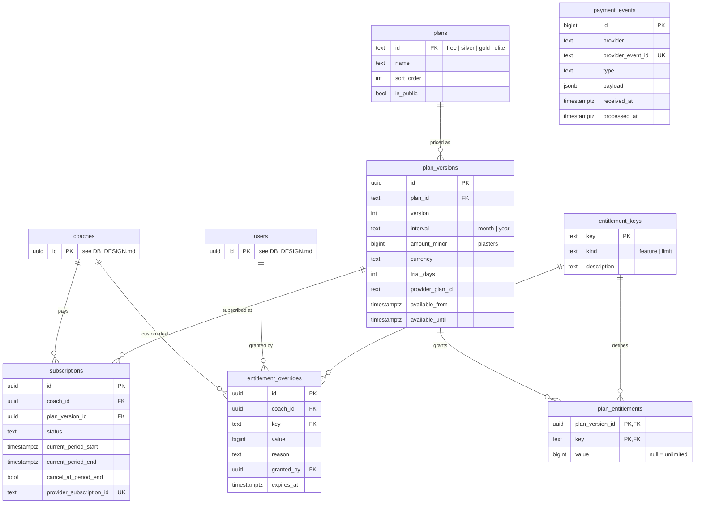

# Choose-Your-Trainer — Plans, Billing & Entitlements

Companion to [DB_DESIGN.md](DB_DESIGN.md); same conventions (§0 there: `uuidv7` PKs, domains, named constraints, `timestamptz`).

**Who pays:** the coach (B2B). Clients never see a plan. They only feel limits like the chat quota.
**Pricing model:** hybrid. A base tier sized by **active clients** (what the market charges by: Everfit, Trainerize) plus an **included AI quota**, which is the variable cost.
**Core rule:** code checks *entitlement keys* (`limit.active_clients`, `feature.ai_chat`), never plan names. Plans are rows, so a new tier, price change or promo is a data change, not a deploy.

---

## 1. Tiers (proposed seed data)

### 1.1 Never gated: every tier, every subscription state
Plan view · "Today" screen · set logging · exercise videos · glossary · client's own history/PRs.
This is the core value. A coach's clients must never lose it, even if the coach's card fails.

### 1.2 Gated
| Entitlement key | Free | Silver | Gold | Elite |
|---|---|---|---|---|
| `limit.active_clients` | 3 | 15 | 40 | 100 |
| `limit.plan_uploads_per_month` | 2 | 15 | 50 | 200 |
| `feature.ai_chat` | 1 | 1 | 1 | 1 |
| `limit.chat_messages_per_client_month` | 20 | 60 | 100 | 120 |
| `limit.chat_messages_per_client_day` | 15 | 30 | 30 | 30 |
| `feature.adherence_dashboard` (who trained this week) | 1 | 1 | 1 | 1 |
| `feature.progress_dashboard` (volume, top sets, PRs per client) | 0 | 1 | 1 | 1 |
| `feature.session_feedback` (coach comments on sessions) | 0 | 1 | 1 | 1 |
| `feature.custom_exercises` (+ aliases) | 0 | 0 | 1 | 1 |
| `feature.data_export` (CSV of client logs) | 0 | 0 | 1 | 1 |
| `limit.staff_seats` (assistant coaches) | 0 | 0 | 0 | 3 |
| `feature.diet_plans` *(Later)* | 0 | 0 | 1 | 1 |
| `feature.branding` (coach logo/colors) *(Later)* | 0 | 0 | 0 | 1 |
| **Price / month** | 0 | **499 EGP** | **1,299 EGP** | **2,999 EGP** |
| Price / year (2 months free) | — | 4,990 | 12,990 | 29,990 |
| Effective price per client | — | ~33 EGP | ~32 EGP | ~30 EGP |

The daily chat cap stops one client from burning the whole month's quota in a session, and it bounds abuse.

### 1.3 Margin check (worst case = every client uses the full chat quota)
Assumption: one chat message ≈ 8k input + 300 output tokens on Gemini 2.5 Flash ≈ **$0.003 ≈ 0.15 EGP** (at ~50 EGP/USD; re-check the rate). **Verify with `turn_stats()` before launch.** That figure is what every number below depends on.

| Tier | Max msgs/month | Worst-case LLM cost | Price | Worst-case gross margin |
|---|---|---|---|---|
| Free | 3 × 20 = 60 | ~9 EGP | 0 | acquisition cost |
| Silver | 15 × 60 = 900 | ~135 EGP | 499 | ~73% |
| Gold | 40 × 100 = 4,000 | ~600 EGP | 1,299 | ~54% |
| Elite | 100 × 120 = 12,000 | ~1,800 EGP | 2,999 | ~40% |

Real usage is typically 20–40% of a cap, so typical margins are much higher. Uploads cost ~2.5 EGP each (≈ $0.05 per 20-page plan). Fixed infra (~$35 ≈ 1,750 EGP/month) is covered by about 4 Silver coaches.
For comparison, Everfit is ~$2.90/client and Trainerize ~$5/client. These prices are deliberately ~4–5× cheaper for the Egyptian market.

### 1.4 Later: add-ons (same tables, no schema change)
- **AI pack:** +1,000 chat messages for the coach's clients, pooled, ~199 EGP. Implemented as an `entitlement_override` with `expires_at` = end of the billing period.
- **Extra clients:** +10 clients without changing tier. Also an override.

---

## 2. Actions
| # | Actor | Action | Tables touched |
|---|---|---|---|
| B1 | System | Seeds entitlement keys, plans, versions, entitlements | `entitlement_keys`, `plans`, `plan_versions`, `plan_entitlements` |
| B2 | Coach | Starts trial / subscribes / upgrades / downgrades / cancels | `subscriptions` |
| B3 | Paymob | Sends a payment / renewal / failure webhook | `payment_events` → `subscriptions` |
| B4 | System | Moves `past_due` → `expired` after the grace period | `subscriptions` |
| B5 | Admin | Grants a custom deal / promo / add-on to one coach | `entitlement_overrides` |
| B6 | API | Checks an entitlement before: adding a client, uploading a plan, sending a chat message, opening a gated screen | view `coach_entitlements` + counts from `users` / `documents` / `llm_usage` |
| B7 | System | Changes prices: new `plan_versions` row; existing subscribers stay on theirs (grandfathered) | `plan_versions` |
| B8 | System | Daily reconciliation against Paymob's inquiry API (catches missed webhooks) | `subscriptions`, `payment_events` |

---

## 3. ERD

`payment_events` has no FK on purpose. It's a raw inbox written before we know which subscription the event belongs to.

---

## 4. Tables

### 4.1 `entitlement_keys` — catalog of everything that can be gated
| Column | Type | Constraints |
|---|---|---|
| key | text | **PK** — namespaced: `feature.*` / `limit.*` |
| kind | text | NN, check in (`feature`,`limit`) |
| description | text_200 | |

### 4.2 `plans`
| Column | Type | Constraints |
|---|---|---|
| id | text | **PK** — `free`, `silver`, `gold`, `elite` |
| name | text_100 | NN |
| sort_order | pos_int | NN — upgrade vs downgrade direction |
| is_public | bool | NN default true (false = custom / legacy) |

### 4.3 `plan_versions` — immutable once a subscriber uses it
| Column | Type | Constraints |
|---|---|---|
| id | uuid | **PK** |
| plan_id | text | **FK → plans.id**, NN |
| version | pos_int | NN · UK `(plan_id, version, interval)` |
| interval | text | NN, check in (`month`,`year`) |
| amount_minor | bigint | NN, `>= 0` — money in **piasters** (integer minor units; never float) |
| currency | text | NN default `EGP`, check `char_length(currency) = 3` |
| trial_days | count_int | NN default 0 |
| provider_plan_id | text | Paymob plan id |
| available_from | timestamptz | NN default now() |
| available_until | timestamptz | null = currently on sale |

Immutability gives grandfathering for free: a price change is a new version, and subscribers keep pointing at the old one until they change plan.

### 4.4 `plan_entitlements`
| Column | Type | Constraints |
|---|---|---|
| plan_version_id | uuid | **PK (part)**, **FK → plan_versions.id** on delete cascade |
| key | text | **PK (part)**, **FK → entitlement_keys.key** |
| value | bigint | features: 1/0 · limits: N · **null = unlimited** |

A key missing from a plan means "not included" (0). Code treats a missing key as denied, so a new feature is off by default.

### 4.5 `subscriptions`
| Column | Type | Constraints |
|---|---|---|
| id | uuid | **PK** |
| coach_id | uuid | **FK → coaches.id**, NN, on delete restrict |
| plan_version_id | uuid | **FK → plan_versions.id**, NN |
| status | text | NN, check in (`trialing`,`active`,`past_due`,`canceled`,`expired`) |
| current_period_start, current_period_end | timestamptz | NN, check end > start |
| cancel_at_period_end | bool | NN default false |
| provider_subscription_id | text | **UK** (Paymob); null for Free |
| created_at, updated_at | timestamptz | NN |

Partial UK `(coach_id) WHERE status IN ('trialing','active','past_due')`: **one live subscription per coach**, enforced by the database. Ended subscriptions stay as history.

### 4.6 `entitlement_overrides` — custom deals and add-ons without code forks
| Column | Type | Constraints |
|---|---|---|
| id | uuid | **PK** |
| coach_id | uuid | **FK → coaches.id**, NN, on delete cascade |
| key | text | **FK → entitlement_keys.key**, NN |
| value | bigint | same meaning as `plan_entitlements.value` |
| reason | text_200 | NN — audit: why it was granted |
| granted_by | uuid | **FK → users.id** |
| expires_at | timestamptz | null = permanent |
| created_at | timestamptz | NN default now() |

### 4.7 `payment_events` — webhook inbox, applied exactly once
| Column | Type | Constraints |
|---|---|---|
| id | bigint | **PK** identity (internal only) |
| provider | text | NN default `paymob` |
| provider_event_id | text | NN · UK `(provider, provider_event_id)` |
| type | text | NN |
| payload | jsonb | NN — raw body, kept for audit and replay |
| received_at | timestamptz | NN default now() |
| processed_at | timestamptz | null = not yet applied |

### 4.8 View `coach_entitlements(coach_id, key, value)`
The live subscription's `plan_entitlements`, overlaid by unexpired `entitlement_overrides` (an override wins over the plan). This is **the only thing the API reads** for gating, loaded once per request. A coach with no live subscription gets the `free` plan's latest version.

Indexes (FK rule from DB_DESIGN §0): `plan_versions(plan_id)`, `plan_entitlements(key)`, `subscriptions(coach_id)` (covered by the partial UK for live rows), `subscriptions(plan_version_id)`, `entitlement_overrides(coach_id, key)`, `entitlement_overrides(granted_by)`, `payment_events(processed_at) WHERE processed_at IS NULL`.

---

## 5. Rules (app layer)

1. **The webhook is the source of truth,** never the payment redirect page. Verify Paymob's HMAC, insert into `payment_events` (a duplicate trips the UK → return 200 and do nothing), then update `subscriptions` **in the same transaction**. Rule B8's daily reconciliation catches webhooks that never arrived.
2. **Limit checks are atomic with the action.** Adding a client locks the coach's live `subscriptions` row (`SELECT … FOR UPDATE`), counts active clients, and inserts in one transaction, so two parallel invites can't both squeeze past the limit.
3. **Usage is counted from tables that already exist:**
   - chat: `llm_usage` (indexed `(user_id, created_at)`), counted from the start of the client's local day/month (`users.timezone`)
   - uploads: `documents.created_at` within the billing period
   - clients: `users` where `role = 'client'` and not archived

   *ponytail:* there's no counters table. Add `usage_counters` only if these counts appear in the slow-query log.
4. **Downgrade or expiry never deletes data.** Over-limit means "can't add more", not "lose what you have". Everything in §1.1 keeps working for existing clients in every state. Only adding clients, uploading plans and AI chat get blocked.
5. **Grace period:** `past_due` keeps full access for **7 days** while Paymob retries the card, then becomes `expired` (restricted as in rule 4).
6. **Upgrade** takes effect immediately; Paymob handles the payment difference. **Downgrade** takes effect at `current_period_end` (sets `cancel_at_period_end` + the next plan). If the coach is over the new tier's client limit, no clients are removed; they just can't add new ones until under the limit.
7. **Warnings at 80% and 100%** of each limit: an upgrade prompt for the coach, and "X messages left this month" for the client in chat.
8. **Paymob setup:** plans are created through Paymob support/account manager (amount, interval, retries, reminders). Subscriptions need an Online 3DS integration ID, plans a MOTO integration ID. A free trial without charging uses a separate 3DS verification integration with `use_transaction_amount: false`. Store the resulting id in `plan_versions.provider_plan_id`.
9. **Lazy path for the first 3–5 coaches:** invoice manually (InstaPay / bank transfer) and set `subscriptions` by hand. Same tables, no Paymob code until manual billing hurts. Ask an accountant about Egypt's ETA e-invoicing before charging.

---

## Sources
- [Entitlement management system for SaaS (Schematic)](https://schematichq.com/blog/entitlement-management-system)
- [The entitlements layer (Schematic)](https://schematichq.com/blog/the-entitlements-layer-how-saas-products-control-customer-access)
- [Feature flags for SaaS monetization (Schematic)](https://schematichq.com/blog/feature-flag-management)
- [Building an entitlement layer that enforces pricing tiers (SaasDash)](https://saasdash.ai/blog/entitlement-enforcement-architecture-pricing)
- [SaaS entitlements and plan gating (skills.lc)](https://skills.lc/peterbamuhigire/skills-web-dev/peterbamuhigire-skills-web-dev-skills-saas-saas-entitlements-and-plan-gating-skill-md)
- [Understanding SaaS entitlements (Ordway)](https://ordwaylabs.com/blog/saas-entitlements/)
- [What are entitlements in SaaS? (Orb)](https://www.withorb.com/blog/what-are-entitlements-in-saas)
- [SaaS subscription architecture 101 (Parth Koshti)](https://parthkoshti.com/blog/saas-subscription-architecture-101-billing-done-properly/)
- [6 AI pricing models in 2026 (Stigg)](https://www.stigg.io/blog-posts/ai-pricing)
- [AI pricing models cheat sheet 2026 (Monetizely)](https://www.getmonetizely.com/articles/the-beginners-cheat-sheet-to-ai-pricing-models-in-2026-11bb6)
- [Trainerize pricing 2026 (QuickCoach)](https://www.quickcoach.fit/trainerize-pricing-2026.html)
- [Everfit vs Trainerize 2026 (Coachway)](https://coachway.io/articles/everfit-vs-trainerize/)
- [Trainerize, TrueCoach, Everfit real costs (Assistant Coach)](https://assistantcoach.fit/blog/real-cost-fitness-coaching-software/)
- [Paymob: create subscription](https://docs.paymob.com/docs/subscription)
- [Paymob: list subscription details](https://developers.paymob.com/egypt/subscriptions-1/list-subscription-details)
