# Agentic-Fitness-Trainer

A B2B SaaS knowledge-ingestion pipeline for gym coaches: a coach uploads a client's training-plan PDF, and it's parsed, cleaned, structured, cross-referenced against a canonical exercise database, and stored as a queryable, versioned knowledge base per client — ready for a retrieval-augmented chatbot to answer questions grounded in what the coach actually wrote.

This README documents the **ingestion pipeline** as it stands today (the query/chat side is not yet built — see [Status](#status)).

## Status

**Built and working:**
- End-to-end PDF ingestion: OCR → structured LLM extraction → day-number resolution → canonical exercise-database enrichment → chunking → incremental storage in MongoDB + Qdrant.
- Bilingual (Arabic/English) content handling throughout.
- Multi-category page extraction — a page's dominant `category` no longer gates which entity lists get populated; a page can genuinely contain more than one kind of content (e.g. advice text that also names a specific exercise) without losing either.
- A dedicated `rest_day` category for standalone single-day rest dividers, resolved to a `day_number` through the exact same matching-against-the-split-table pipeline as `weight_exercise`/`cardio` pages — previously these landed inconsistently in either `program_structure` (with a bogus degenerate table entry) or `other`.
- A day-by-day program view (`program.json`), reshaping the already-enriched extraction into `{day_number, target, weight_exercises, cardio_entries}` per day plus a `general_cardio` bucket for cardio not tied to a specific day — pure post-processing, no extra LLM call.
- Incremental, per-document sync to both stores — re-ingesting one document never touches any other coach's or client's data, and unchanged content is never re-embedded.
- A zero-downtime, verified rebuild path for Qdrant (`reindex()`) for the rare case of a full-corpus rebuild (e.g. changing embedding models).

**Not yet built:**
- The query-time chat/retrieval pipeline itself (`retrieve_demo.py` is a manual vector-search smoke test, not a chat interface).
- A two-hop query resolution for "exercise on day N" style questions — `program.json` now holds exactly this view, but nothing at query time consumes it yet; chunking/retrieval still stays page-based (see [Chunking](#4-chunking-chunks)).
- Video-transcript enrichment (each exercise carries a `video_url`, currently unused beyond storage).

## Flow: from PDF upload to a queryable knowledge base

```mermaid
flowchart TD
    A["Coach uploads a training-plan PDF"] --> B["autocrop.cropped_copy()\n(trim scan margins before OCR)"]

    B --> C1["PaddleOCR-VL\n(cloud OCR, whole-PDF job,\n~30s/page)"]
    B --> C2["PyMuPDF: extract_links()\n(hyperlinks per page,\ntop-to-bottom reading order)"]
    B --> C3["PyMuPDF: extract_native_text()\n(the PDF's own embedded text layer,\nif any)"]
    C1 & C2 & C3 -. run concurrently .-> D

    D["native_text.prefer_native_when_ocr_diverges()\n+ append_missing_native_numbers()\n(catches OCR misreading background/graphic\ntext over an invisible native-text layer)"] --> E["flag_unreliable_pages()\n(warn if a page has neither a\nnative-text fallback nor trustworthy OCR)"]
    E --> F["links.merge_links_into_pages()\n(append a '_Links:' block per page,\nurls kept separate from table cells)"]
    F --> G[("pages.json cache\n(ingestion_output/&lt;doc_id&gt;/)")]

    G --> H["chunks.split into pages\n(one page = one unit, never merged)"]
    H --> I["Batch pages, 4 per call\n(_batch)"]
    I --> J["Gemini 2.5 Flash\nwith_structured_output(TrainingBatchResult)\n(TRAINING_BATCH_PROMPT: page_topic + dominant\ncategory classification, structured entity\nextraction into EVERY matching list -- not\ngated to one category -- blank-cell='0' rule,\nvideo-link placement, OCR-quirk handling)"]
    J --> K["_match_batch_results()\nmatch each result back to its page\nby page_index (order isn't guaranteed);\npage_text = that page's own preprocessed\nOCR markdown (pages.json), not model output"]
    K --> O[("extractions.json cache\n(one TrainingSectionResult per page)")]

    O --> P["enrich.resolve_day_numbers()\nsecond, cheap Gemini call: page-topics only\n(not full text), matches every weight_exercise/\ncardio/other/rest_day page to a Day N from the\nsplit-table page, cross-lingual, disambiguating\nrepeated identical topics (e.g. several\n'REST DAY' pages) by document order"]
    P --> Q["day_number stamped onto\nevery matched page's extraction"]

    Q --> R["enrich.resolve_exercise_reference()\n-> exercise_reference.match_exercises()\n(local, no LLM; collected by list contents,\nnot by category, so an exercise named on any\npage type still gets matched)"]
    R --> R1["rules.py: gazetteer keyword rules\n(word-boundary regex; 'Cable lat pullover'\n→ equipment=Cable, bodypart=Lats;\nalways wins when it fires)"]
    R --> R2["embeddings.py + matching.py:\nBGE-m3 cosine top-5 candidates\n→ RapidFuzz re-rank (case-insensitive)\n→ accept only ≥0.6 combined score"]
    R1 & R2 --> S["ref_type / ref_bodypart / ref_equipment /\nref_level / ref_match_score\nstamped onto each weight_exercise entity"]

    S --> S1["enrich.build_program_view()\npure reshape, no LLM: groups every page's\nweight_exercises/cardio_entries under its\nresolved day_number; unassigned cardio goes\nto general_cardio instead of being duplicated\nor attached to a rest day"]
    S1 --> S2[("program.json\n{days: [...], general_cardio: [...]}")]

    S --> T["chunks.build_all()\nfor every page:\n1 parent record (page-level context)\n+ N leaf records (one per structured\nentity: exercise/cardio/glossary/advice/\nsection-fallback -- a page can produce\nleaves of more than one type now), each\nwith a synthesized embed_text string"]

    T --> U["store_mongo.sync_document()\ndelete this document_id's rows,\nre-insert manifest + parents + entities\n(other documents untouched)"]
    T --> V["store_qdrant.sync_document()\ncontent-hash diff per chunk:\nunchanged → skip re-embedding\nchanged/new → BGE-m3 embed + upsert\nno-longer-produced → delete by point id"]

    U --> W[("MongoDB\ndocuments / parents / entities")]
    V --> X[("Qdrant\ncyt_chunks alias → live generation\n(leaf payload + BGE-m3 vector)")]

    W -. provenance and full-page context .-> Y["Ready for retrieval\n(store_qdrant.search(), filtered by\nclient_id/active/chunk_type/day_number)"]
    X -. vector similarity search .-> Y
```



## Pipeline stages in detail

### 1. Parse (`parse.py`, `ocr/`, `links.py`)
- `autocrop.cropped_copy()` trims scan margins before sending the PDF to OCR.
- Three independent, concurrently-run extractions: **PaddleOCR-VL** (cloud, whole-PDF job submission + polling, the slow ~30s/page step), **PyMuPDF link extraction** (hyperlinks, sorted top-to-bottom/left-to-right to match reading order), and **PyMuPDF native-text extraction** (the PDF's own embedded text layer, when present).
- `native_text.py` reconciles OCR against native text: if OCR's output for a page is missing numbers that the native layer has, that's treated as a sharp, false-positive-resistant signal that OCR silently dropped real data (e.g. misreading a background graphic instead of an invisible native-text table) — the missing numbers get appended back in. `flag_unreliable_pages()` warns when a page has neither signal to trust.
- `ocr/tables.py` compacts raw HTML `<table>` markup from PaddleOCR-VL into a token-lean custom format (`TABLE[type=data]`/`TABLE[type=mapping]`, columns line + pipe-separated rows) before anything reaches an LLM.
- `links.merge_links_into_pages()` appends a `_Links:` block per page rather than inlining URLs into table cells — this is what lets the extraction prompt tell the model to reconstruct full markdown tables with a video-link column, and keeps table cells faithful to the raw OCR output (blank stays blank).
- Result is cached to `ingestion_output/<doc_id>/pages.json`; a re-run reuses it instead of re-hitting the OCR API.

### 2. Structured extraction (`extraction/extract.py`, `extraction/models.py`, `extraction/prompts.py`)
- Pages are batched **4 per Gemini call** (`PAGES_PER_LLM_CALL`), not one call per page — cuts LLM call count roughly 5x. Each page is tagged with `page_index` in the prompt so the model's response can be matched back to its source page even if it reorders or drops one.
- Schema (`TrainingSectionResult`, Pydantic + `with_structured_output`): a `category` (`weight_exercise` / `cardio` / `glossary` / `advice` / `program_structure` / `rest_day` / `marketing` / `other`) plus entity lists — the model only classifies and extracts structured fields, it doesn't reconstruct page text. `category` is the page's *dominant* type, not an exclusive gate: every list gets populated with whatever content actually matches it, so a page can legitimately contain more than one kind of content (e.g. mostly advice text that also names one exercise). `program_structure` is reserved for the real multi-day split table; a standalone page marking just one day as rest (no table of other days) is `rest_day` instead — previously both landed in `program_structure`, inconsistently, with the single-day page getting a degenerate one-entry `program_days`.
- `page_text` is **not model output**: it's set directly from that page's own preprocessed OCR markdown (`ocr/preprocess.py`'s `strip_noise` output, i.e. what's already in `pages.json`), which turned out to need no further LLM cleanup on top of it. It still flows through the rest of the pipeline (parent record text, fallback "section" leaves) exactly as before.
- `NumberRange {low, high}` replaces loose strings for sets/reps/RIR/speed/incline — a single number becomes `{low: N}`, a range becomes `{low, high}`, a non-numeric value ("AMRAP", "to failure") becomes `null`, and a genuinely blank table cell becomes `{low: 0}` (the model is taught the difference between "no value written" and "not applicable").
- Both the raw OCR pages and the LLM extraction output are cached (`extractions.json`) so a re-run skips Gemini entirely if nothing changed.

### 3. Enrichment (`enrich.py`, `exercise_reference/`)
Two independent post-extraction passes over one document's `all_extractions`, run by `enrich.enrich_document()` after `extract_document()` returns, plus a third pure reshape pass called separately from `ingest.py`:
- **Day-number resolution** (`enrich.resolve_day_numbers` → `assign_day_numbers`): a second, much cheaper Gemini call — page *topics* only, not full page text — matches every `weight_exercise`/`cardio`/`other`/`rest_day` page (`_is_day_candidate`) to a `Day N` from the plan's real split-table page (`_is_split_table`: a `program_structure` page with more than one day entry — a `rest_day` page can never be mistaken for the table itself, since that's a separate category now). Handles cross-lingual topic phrasing (e.g. an Arabic page topic matching an English day label), and when multiple days share an identical description (several pages all just "REST DAY"), disambiguates by document order rather than colliding them onto one day or leaving them unresolved. Pages that don't clearly belong to any day are left unassigned rather than guessed.
- **Canonical exercise enrichment** (`enrich.resolve_exercise_reference` → `exercise_reference/`): purely local — **no LLM call**. Every extracted exercise name (collected by list contents across all pages, not gated by category) is resolved against a static reference set (2,909 deduplicated rows from the public `megaGymDataset`) to attach canonical `type`/`bodypart`/`equipment`/`level` fields, via a two-layer funnel:
  1. **Gazetteer keyword rules** (`rules.py`): word-boundary regex over the exercise name ("Cable lat pullover" → `equipment=Cable`, `bodypart=Lats`). Near-certain precision when a rule fires, and always wins over whatever the similarity layer would have said for that field — so a rule needs to be genuinely unambiguous, or it'll silently overwrite a correct similarity match (a `"grip"` → Forearms rule used to fire on any "wide grip"/"close grip" exercise regardless of actual bodypart; removed).
  2. **Hybrid similarity match** (`embeddings.py` + `matching.py`): BGE-m3 cosine similarity (same embedding model used for the vector store) proposes the top-5 candidates, re-ranked by a RapidFuzz string score (both sides lowercased before comparing — `token_sort_ratio` doesn't normalize case on its own, and a correct match differing only in capitalization could otherwise score worse than a same-case wrong one); accepted only above a 0.6 combined threshold, otherwise nothing is attached rather than risking a wrong guess.
  
  Reference embeddings are computed once and cached to disk (`exercise_reference/data/exercises_embeddings.npy`, gitignored) — never recomputed on a normal ingestion run.
- **Day-by-day program view** (`enrich.build_program_view`, called from `ingest.py` after both passes above): a pure reshape of the already-enriched `all_extractions`, no LLM and nothing mutated. Every split-table day gets the `weight_exercises`/`cardio_entries` pulled from whichever pages resolved to its `day_number` (a rest day naturally ends up with empty lists); cardio with no resolved `day_number` goes into a separate `general_cardio` list instead of being duplicated onto every training day or attached to a rest day. Written to `ingestion_output/<doc_id>/program.json`. This is an additional view for understanding the whole week at once — it doesn't feed or replace `chunks.build_all`, which stays page-based (see below).

### 4. Chunking (`chunks/`)
- One **parent** record per page (full-page context, for retrieval-time expansion) and one **leaf** record per structured entity (exercise, cardio entry, glossary term, advice item), each carrying a synthesized `embed_text` string built from its own fields (not from the page's full prose) plus a `day_number`-aware prefix ("Day 1 - Chest & Back > Incline chest press: ..."). `build_leaves` runs every category's builder and concatenates the results, rather than dispatching to a single one — a page can produce leaves of more than one `chunk_type` now, matching extraction no longer gating entity lists by a single category.
- A page with none of the above (prose-only, e.g. category `other`) falls back to one generic "section" leaf built from `page_text`. A `marketing`, `program_structure`, or `rest_day` page produces no leaves at all — the latter two's day/target mapping only ever exists to stamp `day_number` onto other pages (see [Enrichment](#3-enrichment-enrichpy-exercise_reference)).
- Chunking stays strictly page-based, independent of `enrich.build_program_view`'s day-by-day view (glossary/advice/marketing content has no natural place in a day-by-day structure, and other categories still need their own retrievable chunks).

### 5. Storage — incremental, isolated per document (`store_mongo.py`, `store_qdrant.py`)
- **MongoDB**: `sync_document()` deletes and re-inserts only this `document_id`'s rows across `documents`/`parents`/`entities` — no other document is ever touched.
- **Qdrant**: `sync_document()` diffs by a content hash of each chunk's `embed_text` against what's already stored for that document — unchanged chunks are never re-embedded or re-upserted, changed/new ones are, and chunks no longer produced (e.g. an exercise removed from a plan) are deleted by point id.
- **Zero-downtime full rebuild path** (`reindex()`, used only for rare full-corpus operations like switching embedding models): builds into a freshly-named collection, verifies an exact point count, then atomically flips the `cyt_chunks` alias onto it — `search()` always reads through that alias, so it never sees a missing or half-built collection, and a failed build never touches what's live. The previous generation is kept as an instant manual rollback.

## Project structure

```
Ingestion_Pipeline/
├── ingest.py                  # orchestrates one document end-to-end; main() loops DOCUMENTS
├── parse.py                   # OCR + links + native-text merge
├── links.py                   # PyMuPDF hyperlink extraction/merge
├── enrich.py                  # post-extraction: day-number resolution, exercise-reference matching, day-by-day program view
├── lazy.py                    # lazy-singleton helper (shared by store_qdrant/extract/embeddings)
├── text_utils.py              # shared regex helpers (NUMBER, word-boundary pattern builder)
├── ocr/
│   ├── paddle_api.py          # PaddleOCR-VL cloud job submission/polling
│   ├── autocrop.py            # trim scan margins before OCR
│   ├── native_text.py         # native-text vs OCR reconciliation
│   ├── preprocess.py          # OCR text cleanup (abbreviation normalization, etc.)
│   └── tables.py              # raw HTML tables -> compact TABLE[...] text
├── extraction/
│   ├── extract.py             # batched Gemini calls: category classification + structured entity extraction
│   ├── models.py              # Pydantic schemas (TrainingSectionResult, NumberRange, ...)
│   └── prompts.py             # TRAINING_BATCH_PROMPT, DAY_ASSIGNMENT_PROMPT
├── exercise_reference/
│   ├── rules.py                # gazetteer keyword rules
│   ├── embeddings.py           # BGE-m3 loading + cached reference embeddings
│   ├── matching.py             # similarity funnel + rule/match merge
│   └── data/exercises.json     # 2,909-row reference set (megaGymDataset)
├── chunks/
│   ├── build.py                # per-page parent + leaf assembly
│   └── leaves.py               # category-specific leaf builders, embed_text synthesis
├── store_mongo.py             # incremental per-document Mongo sync
├── store_qdrant.py            # incremental per-document Qdrant sync + zero-downtime reindex
└── retrieve_demo.py           # manual vector-search smoke test (not a chat interface)
```

## Running it

Requires `.env` with `GOOGLE_API_KEY`, `PADDLEOCR_TOKEN`, `QDRANT_URL`, `QDRANT_API_KEY`, and `MONGODB_URL` (defaults to `mongodb://localhost:27017/`).

```bash
cd Ingestion_Pipeline
python ingest.py
```

Edit `DOCUMENTS` in `ingest.py` to point at the PDF(s) to ingest. Re-running is safe and incremental — cached OCR/extraction output is reused, and only changed content triggers new embedding calls. Each run writes `ingestion_output/<doc_id>/{pages,extractions,program,manifest}.json` and `merged.md`.

To manually check what a query retrieves:

```bash
python retrieve_demo.py "what are my chest exercises"
python retrieve_demo.py --chunk-type weight_exercise,cardio "list my leg exercises"
```
